## Características

- Sistema Desktop
- Banco de Dados SQLite
- Interface Moderna com CustomTkinter
- Geração automática de PDF
- Controle completo de estoque

# ⚡ Sistema Auto Elétrica Emerson

Sistema desktop desenvolvido em **Python** para gerenciamento completo de uma Auto Elétrica.

O projeto foi desenvolvido para utilização em um ambiente real, permitindo o controle de clientes, veículos, estoque, ordens de serviço, financeiro e emissão de PDFs.

---

# Dashboard

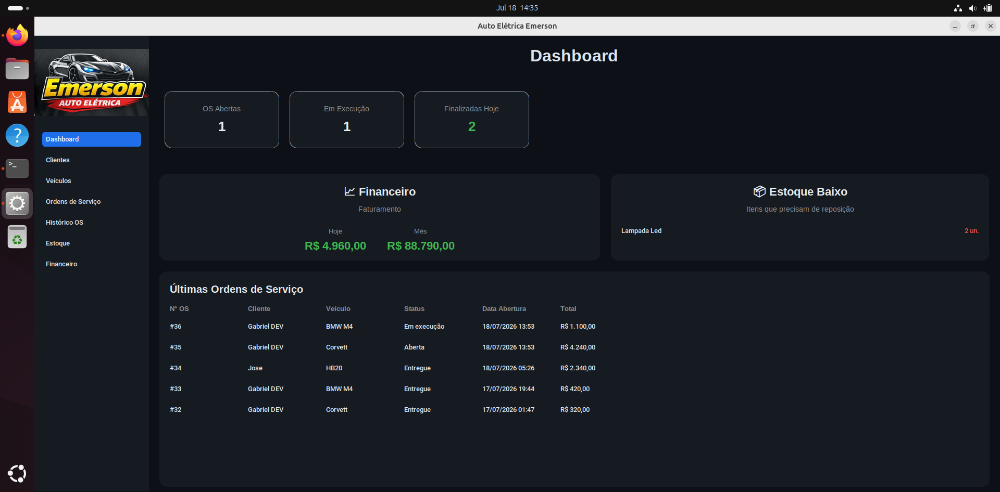

---

# Funcionalidades

- 📊 Dashboard
- 👤 Cadastro de Clientes
- 🚗 Cadastro de Veículos
- 📦 Controle de Estoque
- ➕ Entrada de Produtos
- ➖ Baixa automática de estoque
- 🔧 Cadastro de Ordens de Serviço
- 💰 Controle Financeiro
- 📄 Geração de PDF da Ordem de Serviço
- 💾 Banco de dados SQLite

---

# Tecnologias Utilizadas

- Python
- CustomTkinter
- SQLite
- ReportLab
- Pillow

---

# Galeria

## Clientes

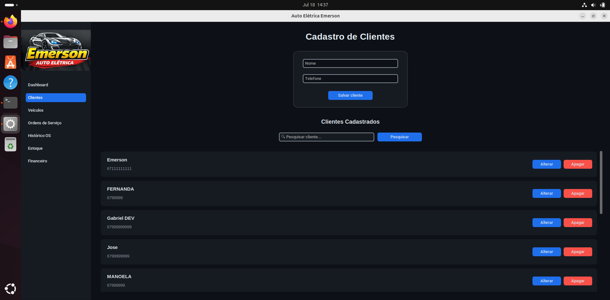

---

## Veículos

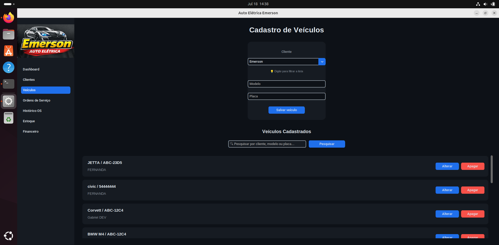

---

## Estoque

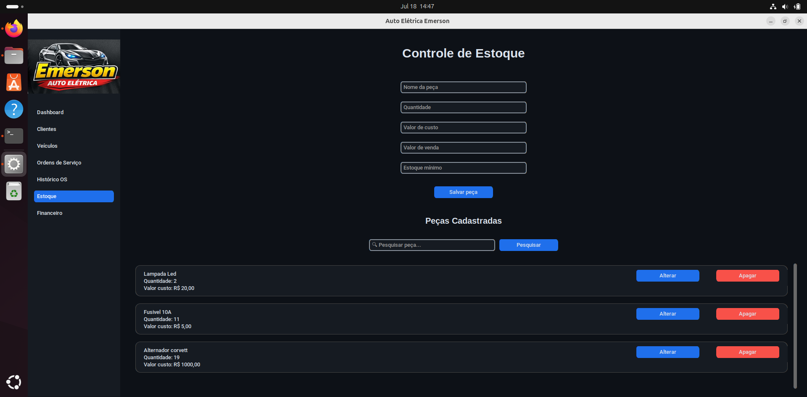

---

## Ordem de Serviço

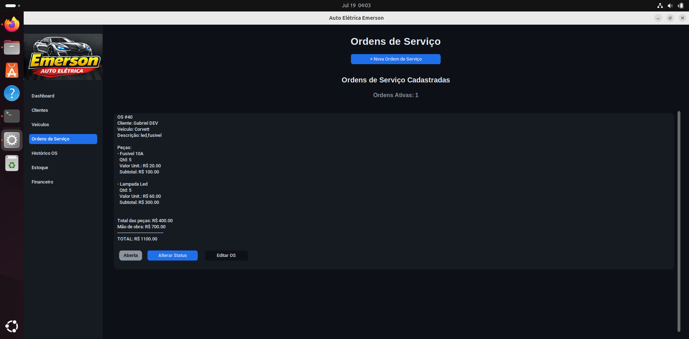

## Nova os

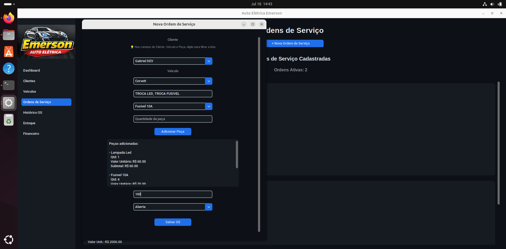

---

## Tratamento de erro

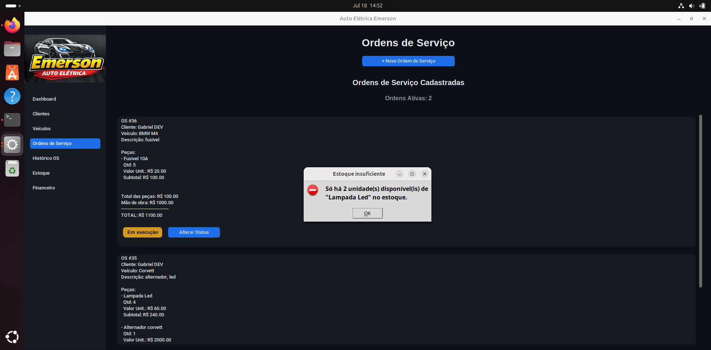

---

## Historico OS

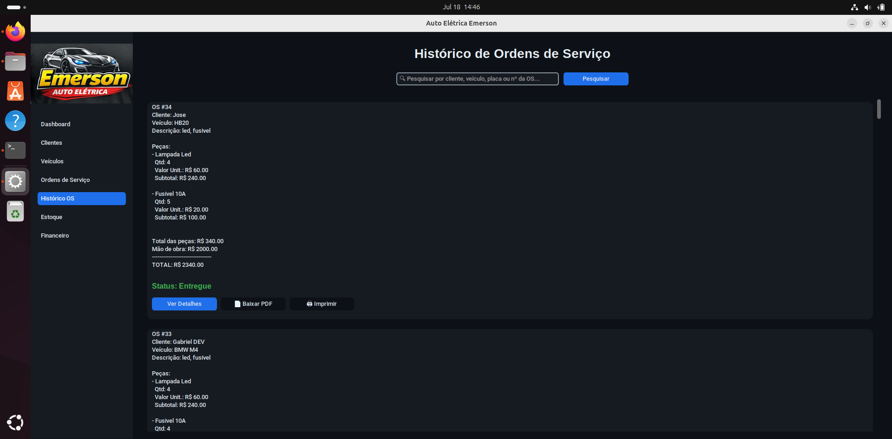

---

## Financeiro

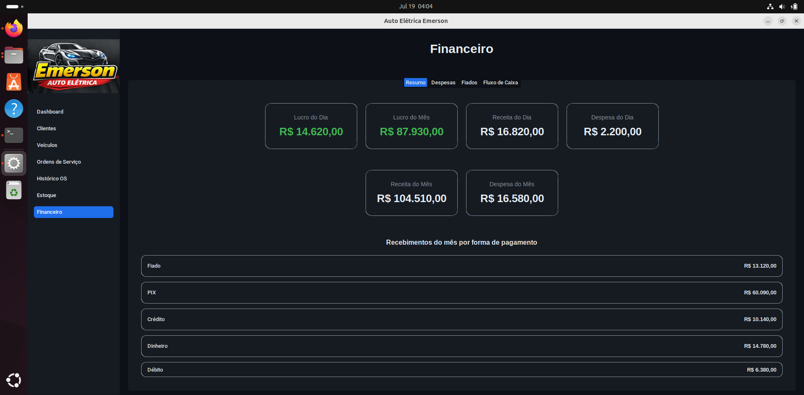

---

## Despesas Financeiro

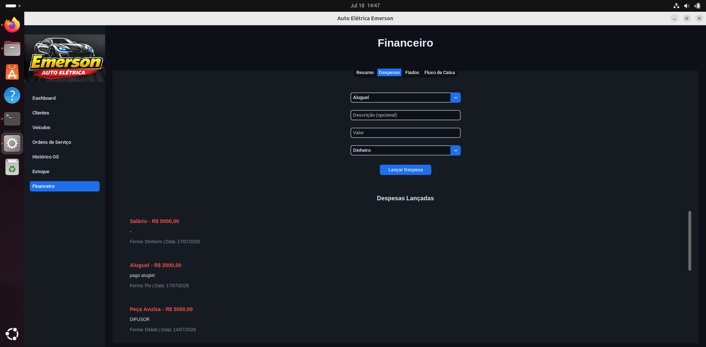

---

## Aba fiado

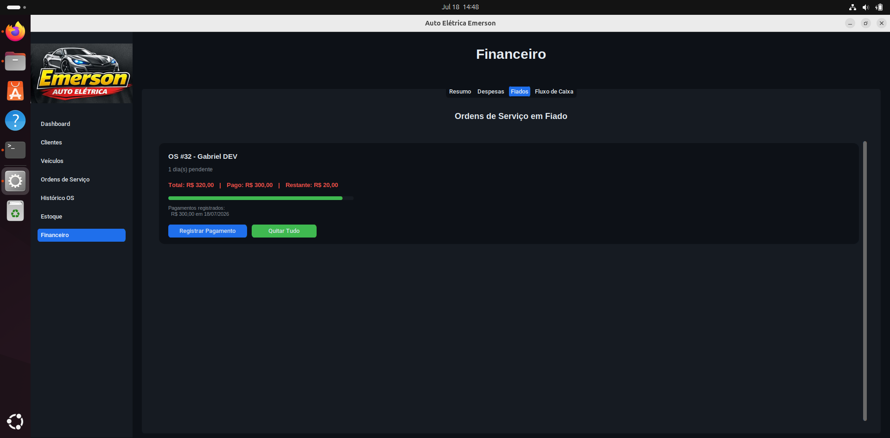

---

## Aba fluxo

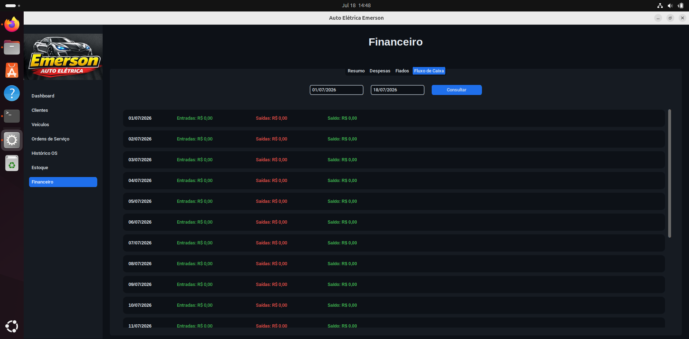

---

## PDF

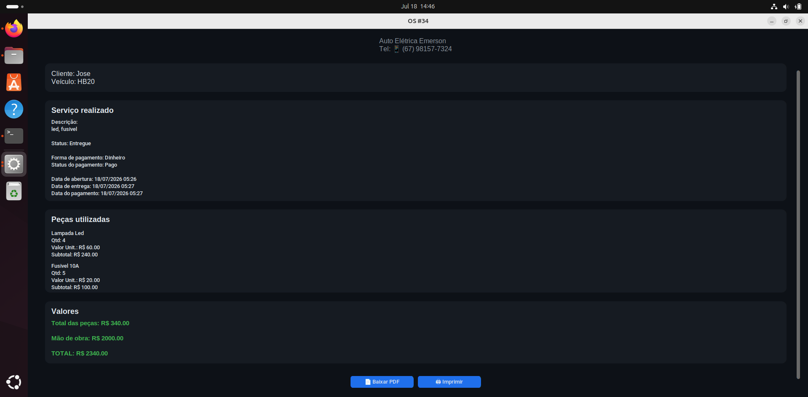

---

# Estrutura do Projeto

```text
AutoEletrica_Emerson/

assets/
screenshots/

main.py
database.py
pdf_os.py

autoeletrica.db

requirements.txt
README.md
.gitignore
```

---

# Como executar

Clone o projeto

```bash
git clone https://github.com/SEU-USUARIO/AutoEletrica_Emerson.git
```

Entre na pasta

```bash
cd AutoEletrica_Emerson
```

Crie um ambiente virtual

```bash
python -m venv venv
```

Linux

```bash
source venv/bin/activate
```

Windows

```cmd
venv\Scripts\activate
```

Instale as dependências

```bash
pip install -r requirements.txt
```

Execute

```bash
python main.py
```

---

# Melhorias Futuras

- Sistema de Login
- Controle de permissões
- Backup automático
- Dashboard com gráficos
- Relatórios financeiros

---

# Autor

**Gabriel Vinicius**

Projeto desenvolvido para utilização em uma Auto Elétrica real e também como projeto de portfólio para demonstrar conhecimentos em desenvolvimento de software utilizando Python.
